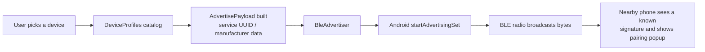
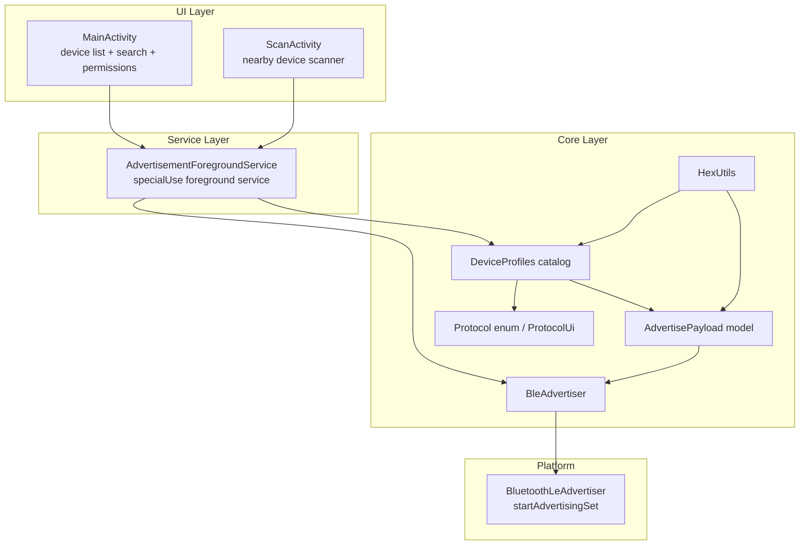

<div align="center">

# 📡 BLE Advertise

### Spoof Bluetooth Low Energy devices and trigger real pairing popups on nearby phones.

**BLE Advertise** is an Android app that advertises **fake Bluetooth Low Energy (BLE) devices** so you can trigger the exact pairing notifications a real device would show — **Google Fast Pair**, **Apple AirPods**, **Samsung Galaxy Watch / Buds** and **Microsoft Swift Pair** — with one tap.

[](https://github.com/kamalesh4044/BLE-Advertise/actions/workflows/build-apk.yml)
[](LICENSE)
[](app/src/main/java/com/kamalesh/bleadvertise)
[](app/build.gradle.kts)
[](app/build.gradle.kts)

**A clean-room, educational implementation of Bluetooth advertising spoofing — 37 built-in device profiles, 4 spoofing protocols, and a CI-published APK.**

**English** | [简体中文](README.md)

</div>

---

## 📖 About

BLE advertising is just bytes in the air. When a phone's radio receives a well-formed advertisement that matches a known device signature, the operating system shows a pairing popup for that product — even though no real device exists nearby.

**BLE Advertise** lets you broadcast those exact byte patterns from any Android phone. Pick a device, tap **Start Advertising**, and nearby phones will show the pairing notification for that product.

> ⚠️ **This is an educational and security-testing tool.** Use it on **your own devices**, for demos, or to understand how BLE advertising works — not to annoy or harass other people.

> 🚫 **What it does NOT do:** a phone that merely sees (or even connects to) a BLE advertisement **never** grants the advertiser access to its microphone, speaker, storage, or personal data. Bluetooth simply does not work that way, and no app built like this one — including this one — can "extract data from a connected phone". **Treat any app that claims this as a red flag.**

---

## ✨ Features

* 🎧 **Google Fast Pair** — Spoof Android Fast Pair devices (Pixel Buds, Sony, Bose, JBL, Beats, OnePlus, Xiaomi, realme, Jabra, soundcore, TicWatch, Fitbit, Galaxy …) using real 3-byte model IDs over service UUID `0xFE2C`.
* 🍎 **Apple AirPods** — Spoof AirPods, AirPods 2nd/3rd Gen, AirPods Pro 1st/2nd Gen and AirPods Max via the Apple Continuity manufacturer-data protocol (`0x004C`).
* ⌚ **Samsung Easy Setup** — Spoof Galaxy Watch 4/5/6 and Galaxy Buds 2 / Buds Live with the Samsung Easy Setup protocol (`0x0075`).
* 💻 **Microsoft Swift Pair** — Spoof Swift Pair devices like the Xbox Controller and Surface line (`0x0006`).
* 🔍 **Nearby scanner** — Scan surrounding BLE advertisements, identify their protocol, and spoof a matching device in one tap.
* 🔁 **Foreground service** — Advertising keeps running with the screen off or the app backgrounded, via a `specialUse` foreground service.
* 💾 **Persistent selection** — Your chosen device is remembered across restarts (`START_STICKY` service, `SharedPreferences`).
* 🛡️ **Runtime permissions** — Correct permission flows for Android 12+ (BLE) and legacy devices (location-based BLE).
* 🎨 **Material 3 UI** — Card-based device list, category filters, live search, status pulse animation and dark mode. The UI ships in Simplified Chinese and English.
* ⚡ **CI-built APK** — Every push to `main` produces a signed debug APK as a GitHub Actions artifact.

**37 built-in device profiles across 4 spoofing protocols.**

| Category | Protocol | Profiles |
| --- | --- | --- |
| Google Fast Pair | Service UUID `0xFE2C` | 18 |
| Apple Continuity | Manufacturer `0x004C` | 6 |
| Samsung Easy Setup | Manufacturer `0x0075` | 10 |
| Microsoft Swift Pair | Manufacturer `0x0006` | 3 |

---

## 🎯 Problem

Modern phones make pairing **almost invisible**. When you bring a set of earbuds or a smartwatch near a phone, a popup appears instantly and pairing "just works".

But that magic is built on **trust in bytes**. Each brand publishes a recognizable advertising signature:

* Google Fast Pair devices advertise a 3-byte **model ID** under service UUID `0xFE2C`
* Apple AirPods advertise an **Apple Continuity** packet under manufacturer ID `0x004C`
* Samsung watches and buds advertise an **Easy Setup** packet under manufacturer ID `0x0075`
* Microsoft devices advertise a **Swift Pair** packet under manufacturer ID `0x0006`

Any phone that understands these signatures shows a pairing popup on sight — **without verifying that a real product is transmitting**.

**Why this matters:** advertisement spoofing is a known research and security topic (see projects like [Bluetooth-LE-Spam](https://github.com/simondankelmann/Bluetooth-LE-Spam) and [Flipper Xtreme](https://github.com/Flipper-XFW/Xtreme-Firmware)). Understanding how these popups are triggered is essential for security testing, awareness, and education about how much of "wireless pairing" is actually just pattern matching.

---

## 💡 Solution

BLE Advertise packages this knowledge into a simple, one-tap Android app.



1. **Choose a device** from a curated catalog of 37 profiles.
2. **The app builds the raw advertisement bytes** — the exact Fast Pair model ID, Continuity packet, Easy Setup frame, or Swift Pair frame for that product.
3. **Android's BLE advertiser broadcasts them** on a short advertising interval.
4. **Nearby phones recognize the signature** and display the corresponding pairing notification.

---

## 🏗️ Architecture

A minimal, clean Kotlin architecture built on Android's `AdvertisingSet` API (API 26+).



### Components

| Component | Responsibility |
| --- | --- |
| **`MainActivity`** | Renders the device catalog with search and category filters, requests runtime permissions, and starts/stops advertising. |
| **`ScanActivity`** | Scans nearby BLE advertisements, identifies their protocol, and can spoof a matching device in one tap. |
| **`AdvertisementForegroundService`** | A `specialUse` foreground service that keeps advertising alive with the screen off, restores state on restart, and shows a status notification with a Stop action. |
| **`BleAdvertiser`** | Thin wrapper around `BluetoothLeAdvertiser.startAdvertisingSet()` with legacy-mode, non-connectable parameters. |
| **`DeviceProfiles`** | The static catalog of 37 spoofable devices, encoding each protocol's byte layout. |
| **`DeviceProfile` / `Protocol`** | The profile model and the enum of the four protocols. |
| **`ProtocolUi`** | Maps each protocol to its display name, icon and category. |
| **`AdvertisePayload`** | Immutable data model describing a single advertisement (service UUID/data, manufacturer data, scan response). |
| **`HexUtils`** | Hex string ⇄ `ByteArray` helpers used to define payloads. |

---

## 🛠️ Tech Stack

| Technology | Purpose |
| --- | --- |
| **Kotlin** | Primary language (JVM target 17) |
| **Android SDK 35** | `compileSdk` / `targetSdk` |
| **minSdk 26** | Supports Android 8.0 and above |
| **Material 3** | Modern UI (`Theme.Material3.DayNight`) |
| **AndroidX** | `core-ktx` 1.15.0, `appcompat` 1.7.0, `recyclerview` 1.3.2, `coordinatorlayout` 1.2.0, `activity-ktx` 1.9.3 |
| **Material Components** | `material` 1.12.0 |
| **Android Gradle Plugin** | 8.7.3 |
| **Gradle** | 8.9 |
| **GitHub Actions** | Automated APK build on every push |

---

## 📂 Project Structure

```text
BLE-Advertise/
├── .github/
│   └── workflows/
│       └── build-apk.yml          # CI: builds & publishes the debug APK
├── app/
│   ├── build.gradle.kts           # Module config (SDK 35, Kotlin 17, deps)
│   ├── proguard-rules.pro
│   └── src/main/
│       ├── AndroidManifest.xml    # BLE + foreground-service permissions
│       ├── java/com/kamalesh/bleadvertise/
│       │   ├── MainActivity.kt                # UI + device selection + search
│       │   ├── ScanActivity.kt                # Nearby device scanner
│       │   ├── AdvertisementForegroundService.kt
│       │   ├── BleAdvertiser.kt               # startAdvertisingSet wrapper
│       │   ├── DeviceAdapter.kt               # Device list adapter
│       │   ├── ScanAdapter.kt                 # Scan result adapter
│       │   ├── DeviceProfiles.kt              # 37-device catalog
│       │   ├── DeviceProfile.kt               # Profile model + Protocol enum
│       │   ├── ProtocolUi.kt                  # Protocol name/icon mapping
│       │   ├── AdvertisePayload.kt            # Advertisement data model
│       │   └── HexUtils.kt                    # Hex helpers
│       └── res/
│           ├── layout/  (activity_main, activity_scan, item_device,
│           │             item_section_header, item_scan_result)
│           ├── values/       (strings, colors, themes — Simplified Chinese, default)
│           ├── values-en/    (strings — English)
│           ├── values-night/ (colors, themes — dark mode)
│           └── drawable/ + drawable-night/ + mipmap-anydpi-v26/
├── build.gradle.kts               # Root build (AGP + Kotlin plugins)
├── gradle.properties
├── gradle/wrapper/gradle-wrapper.properties
├── settings.gradle.kts
├── LICENSE                        # MIT
├── README.md                      # 简体中文
└── README.en.md                   # English
```

**Key directories:** `java/com/kamalesh/bleadvertise/` holds all application logic, `res/` holds the UI resources, and `.github/workflows/` contains the CI pipeline.

---

## ⚙️ Installation

### Prerequisites

| Requirement | Version / Notes |
| --- | --- |
| **JDK** | 17 or newer (Temurin recommended) |
| **Gradle** | 8.9 (or use Android Studio's wrapper) |
| **Android SDK** | `platforms;android-35`, `build-tools;34.0.0` + `35.0.0` |
| **Android Studio** | Optional — recommended for IDE support |

### Clone

```bash
git clone https://github.com/kamalesh4044/BLE-Advertise.git
cd BLE-Advertise
```

### Build from the command line

```bash
# From the project root
gradle assembleDebug --no-daemon
```

The APK is written to:

```text
app/build/outputs/apk/debug/app-debug.apk
```

### Build in Android Studio

1. Open the project folder in **Android Studio**.
2. Android Studio will download the Gradle wrapper distribution automatically.
3. Run the `app` configuration or build via **Build → Build APK(s)**.

> 🔑 **No secrets required.** This project has no API keys or environment variables — clone, build, run.

---

## ▶️ Usage

1. **Install the APK** on an Android device (Android 8.0+ with Bluetooth LE support).
2. **Launch the app** — grant the requested permissions (Bluetooth, notifications, and location on Android 11 or older).
3. **Select a device** from the catalog, grouped by protocol, with search and category filters:
   * *Google Fast Pair (Android)* — 18 profiles
   * *Apple Continuity (AirPods)* — 6 profiles
   * *Samsung Easy Setup* — 10 profiles
   * *Microsoft Swift Pair (Windows)* — 3 profiles
4. **Tap Start Advertising.**
5. Bring the phone near another phone — it will show the matching pairing popup.
6. Tap **Stop Advertising** (or the notification's **Stop** action) when done.

> 💡 Advertising runs in a **foreground service**, so it continues even if you lock the screen or open another app. Your selected device is remembered the next time you open the app.

**Scan nearby devices:** tap **Scan for Nearby Devices** at the bottom to discover surrounding BLE advertisements, identify their protocol, and spoof a matching device in one tap.

---

## 🖥️ Screenshots / Demo

> 📷 *Screenshots are not yet included in this repository. A dedicated media section is planned — see the [Roadmap](#-roadmap).*

**No live demo is hosted** — this is a native Android app intended to run on a physical device.

---

## 🧪 Testing

There is **no automated test suite in this repository yet**. The project currently relies on manual device testing (build → install → advertise → observe the popup on a second phone).

Automated unit/instrumentation tests are planned — see the [Roadmap](#-roadmap).

> ✅ The project *is* continuously verified for compilation: every push to `main` runs `gradle assembleDebug` in CI.

---

## 🔐 Security & Responsible Use

* **Spoofing is about awareness.** This project demonstrates how pairing popups are triggered. Use it on devices you own or control.
* **It cannot harm other phones.** A BLE advertisement is a one-way broadcast. The receiving phone does not expose its microphone, camera, storage, or data to the advertiser — ever.
* **Permissions are the minimum required by the platform** for BLE advertising and foreground-service operation; no data is collected, transmitted, or stored by this app beyond your locally saved device preference.
* **No secrets, ever.** This repository contains no credentials. Never commit API keys, tokens, or secrets to any repository.

---

## 🗺️ Roadmap

### ✅ Completed

- [x] Fast Pair spoofing (18 profiles)
- [x] Apple Continuity / AirPods spoofing (6 profiles)
- [x] Samsung Easy Setup watch & buds spoofing (10 profiles)
- [x] Microsoft Swift Pair spoofing (3 profiles)
- [x] Nearby device scanning with one-tap spoofing
- [x] Foreground-service advertising with persistent state
- [x] Runtime permission handling for all supported Android versions
- [x] CI pipeline that builds and publishes a debug APK
- [x] Simplified-Chinese localization and Material 3 UI refresh (card list, search, category filters, dark mode)

### 🔮 Planned *(not yet implemented — proposals welcome)*

- [ ] Custom payload editor (craft arbitrary service/manufacturer data)
- [ ] Advertising interval & TX power controls
- [ ] Rotation / cycling through multiple devices automatically
- [ ] Automated unit + instrumentation tests
- [ ] Screenshots and a dedicated in-app "About" page (currently a dialog)
- [ ] Release signing configuration

---

## 🤝 Contributing

Contributions are welcome! To get started:

1. **Fork** the repository.
2. **Create a branch** — `git checkout -b feature/your-feature`.
3. **Make your changes** — follow the existing Kotlin style and structure.
4. **Verify the build** — `gradle assembleDebug` must pass.
5. **Commit** — with a clear, descriptive message.
6. **Push** — `git push origin feature/your-feature`.
7. **Open a Pull Request** — describe the change and how you tested it.

Ideas are welcome too — open an [issue](https://github.com/kamalesh4044/BLE-Advertise/issues) for bugs, feature requests, or new device profiles.

---

## 📜 License

This project is licensed under the **MIT License** — see [LICENSE](LICENSE) for details.

Device model IDs and advertisement formats are referenced from the public [Google Fast Pair](https://developers.google.com/nearby/fast-pair) ecosystem and the open-source [Flipper Xtreme BLE Spam](https://github.com/Flipper-XFW/Xtreme-Firmware) / [Bluetooth-LE-Spam](https://github.com/simondankelmann/Bluetooth-LE-Spam) projects. **BLE Advertise** is an independent, clean-room implementation written for educational purposes.

---

## 👨‍💻 Author

**Kamalesh** — created and maintained by [kamalesh4044](https://github.com/kamalesh4044).

---

## ⭐ Support

If you find this project useful or interesting:

* ⭐ **Star the repository** to show support
* 🐛 **Report issues** — bug reports and feature requests are welcome
* 🚀 **Contribute** — new profiles and protocols are especially valuable
* 💬 **Share feedback** — constructive feedback improves the project

---

<div align="center">

**Bluetooth pairing popups are just pattern matching over the air.**
Understanding that — by reading the bytes, building the packets, and testing your own devices — is how the next generation of wireless developers learns to build better, safer proximity experiences.

**Learn. Test. Build. 🚀**

</div>
