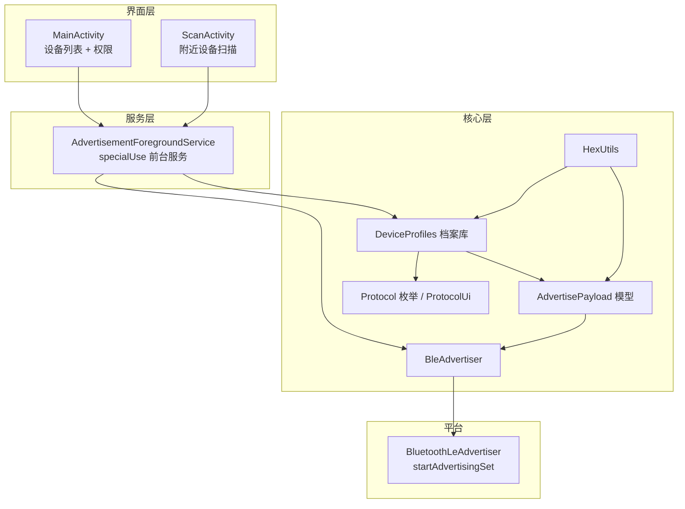

<div align="center">

# 📡 BLE 广播（BLE Advertise）

### 模拟蓝牙低功耗（BLE）设备，在附近手机上触发真实的配对弹窗。

**BLE 广播** 是一款 Android 应用，可广播**虚拟的蓝牙低功耗（BLE）设备**，一键触发真实设备才会出现的配对通知 —— **Google Fast Pair**、**Apple AirPods**、**三星 Galaxy Watch / Buds** 以及 **Microsoft Swift Pair**。

[](https://github.com/kamalesh4044/BLE-Advertise/actions/workflows/build-apk.yml)
[](LICENSE)
[](app/src/main/java/com/kamalesh/bleadvertise)
[](app/build.gradle.kts)
[](app/build.gradle.kts)

**一个净室实现、用于教学目的的蓝牙广播模拟工具 —— 内置 37 款设备档案、4 种模拟协议，并由 CI 自动发布 APK。**

[English](README.en.md) | **简体中文**

</div>

---

## 📖 关于本项目

BLE 广播本质上只是空中的字节。当手机的射频收到一段格式正确、且与已知设备特征相匹配的广播时，系统就会弹出该产品的配对窗口 —— 即使附近根本没有真实设备存在。

**BLE 广播**让你能够从任意 Android 手机广播这些确切的字节序列。选择一款设备，点击**开始广播**，附近的手机就会显示对应的配对通知。

> ⚠️ **这是一款用于教学与安全测试的工具。** 请在**你自己拥有的设备**上使用，用于演示或理解 BLE 广播的原理 —— 切勿用于打扰或骚扰他人。

> 🚫 **它不能做什么：** 仅仅收到（甚至连接到）一段 BLE 广播的手机，**绝不会**因此向广播方开放麦克风、扬声器、存储或个人数据。蓝牙根本不是这样工作的，任何这类应用（包括本应用）都无法"从已连接的手机上窃取数据"。**凡是声称能做到这一点的应用，都应被视为危险信号。**

---

## ✨ 功能特性

* 🎧 **Google Fast Pair** —— 通过服务 UUID `0xFE2C` 上的真实 3 字节型号 ID，模拟 Android Fast Pair 设备（Pixel Buds、Sony、Bose、JBL、Beats、OnePlus、小米、realme、Jabra、soundcore、TicWatch、Fitbit、Galaxy……）。
* 🍎 **Apple AirPods** —— 通过 Apple Continuity 厂商数据协议（`0x004C`）模拟 AirPods、AirPods 二代/三代、AirPods Pro 一代/二代以及 AirPods Max。
* ⌚ **三星 Easy Setup** —— 使用三星 Easy Setup 协议（`0x0075`）模拟 Galaxy Watch 4/5/6 与 Galaxy Buds 2 / Buds Live。
* 💻 **Microsoft Swift Pair** —— 模拟 Xbox 手柄、Surface 系列等 Swift Pair 设备（`0x0006`）。
* 🔍 **附近设备扫描** —— 扫描周围的 BLE 广播，识别其协议，并对可识别的设备一键模拟同款。
* 🔁 **前台服务** —— 通过 `specialUse` 前台服务，即使熄屏或应用切到后台，广播也会持续运行。
* 💾 **选择持久化** —— 你选择的设备会在重启后被记住（`START_STICKY` 服务 + `SharedPreferences`）。
* 🛡️ **运行时权限** —— 针对 Android 12+（BLE）与旧设备（基于定位的 BLE）分别处理正确的权限流程。
* 🎨 **Material 3 界面** —— 全新卡片式设备列表、分类筛选、实时搜索、状态脉冲动画与深色模式。
* ⚡ **CI 构建 APK** —— 每次推送到 `main` 都会通过 GitHub Actions 生成一个已签名的 debug APK 制品。

**4 种模拟协议，共内置 37 款设备档案。**

| 分类 | 协议 | 档案数 |
| --- | --- | --- |
| Google Fast Pair | 服务 UUID `0xFE2C` | 18 |
| Apple Continuity | 厂商 ID `0x004C` | 6 |
| 三星 Easy Setup | 厂商 ID `0x0075` | 10 |
| Microsoft Swift Pair | 厂商 ID `0x0006` | 3 |

---

## 🎯 问题背景

现代手机把配对过程做得**几乎无感**。当你把一副耳机或一块智能手表靠近手机时，弹窗瞬间出现，配对"就这样完成了"。

但这种魔法建立在**对字节的信任**之上。每个品牌都发布了一套可识别的广播特征：

* Google Fast Pair 设备在服务 UUID `0xFE2C` 下广播一个 3 字节的**型号 ID**
* Apple AirPods 在厂商 ID `0x004C` 下广播一个 **Apple Continuity** 数据包
* 三星手表与耳机在厂商 ID `0x0075` 下广播一个 **Easy Setup** 数据包
* 微软设备在厂商 ID `0x0006` 下广播一个 **Swift Pair** 数据包

任何理解这些特征的手机，一看到就会弹出配对窗口 —— **并不会去验证是否真的有对应产品在发送广播**。

**为什么这很重要：** 广播模拟是一个已知的研究与安全课题（参见 [Bluetooth-LE-Spam](https://github.com/simondankelmann/Bluetooth-LE-Spam) 和 [Flipper Xtreme](https://github.com/Flipper-XFW/Xtreme-Firmware) 等项目）。理解这些弹窗是如何被触发的，对于安全测试、风险意识，以及认识"无线配对"在多大程度上只是模式匹配，都至关重要。

---

## 💡 解决方案

BLE 广播把这些知识封装进一个简单的一键式 Android 应用。


1. 从精心整理的 37 款设备档案中**选择一款设备**。
2. **应用构建原始广播字节** —— 即该产品确切的 Fast Pair 型号 ID、Continuity 数据包、Easy Setup 帧或 Swift Pair 帧。
3. **Android 的 BLE 广播器以较短的广播间隔发送它们。**
4. **附近手机识别出该特征**，并显示对应的配对通知。

---

## 🏗️ 架构

基于 Android `AdvertisingSet` API（API 26+）的极简、清晰的 Kotlin 架构。



### 组件说明

| 组件 | 职责 |
| --- | --- |
| **`MainActivity`** | 渲染设备档案库，提供搜索与分类筛选，请求运行时权限，并启停广播。 |
| **`ScanActivity`** | 扫描附近的 BLE 广播，识别协议，并支持一键模拟匹配到的设备。 |
| **`AdvertisementForegroundService`** | `specialUse` 前台服务，在熄屏时保持广播，重启后恢复状态，并显示带「停止」操作的状态通知。 |
| **`BleAdvertiser`** | 对 `BluetoothLeAdvertiser.startAdvertisingSet()` 的轻量封装，使用 legacy 模式、不可连接参数。 |
| **`DeviceProfiles`** | 37 款可模拟设备的静态档案库，编码了每种协议的字节布局。 |
| **`DeviceProfile` / `Protocol`** | 设备档案模型与四类协议的枚举。 |
| **`ProtocolUi`** | 协议的界面呈现：名称、图标与分类。 |
| **`AdvertisePayload`** | 描述单条广播（服务 UUID/数据、厂商数据、扫描响应）的不可变数据模型。 |
| **`HexUtils`** | 用于定义数据载荷的十六进制字符串 ⇄ `ByteArray` 辅助方法。 |

---

## 🛠️ 技术栈

| 技术 | 用途 |
| --- | --- |
| **Kotlin** | 主要语言（JVM target 17） |
| **Android SDK 35** | `compileSdk` / `targetSdk` |
| **minSdk 26** | 支持 Android 8.0 及以上 |
| **Material 3** | 现代界面（`Theme.Material3.DayNight`） |
| **AndroidX** | `core-ktx` 1.15.0、`appcompat` 1.7.0、`recyclerview` 1.3.2、`coordinatorlayout` 1.2.0、`activity-ktx` 1.9.3 |
| **Material Components** | `material` 1.12.0 |
| **Android Gradle Plugin** | 8.7.3 |
| **Gradle** | 8.9 |
| **GitHub Actions** | 每次推送自动构建 APK |

---

## 📂 项目结构

```text
BLE-Advertise/
├── .github/
│   └── workflows/
│       └── build-apk.yml          # CI：构建并发布 debug APK
├── app/
│   ├── build.gradle.kts           # 模块配置（SDK 35、Kotlin 17、依赖）
│   ├── proguard-rules.pro
│   └── src/main/
│       ├── AndroidManifest.xml    # BLE + 前台服务权限
│       ├── java/com/kamalesh/bleadvertise/
│       │   ├── MainActivity.kt                # 主界面 + 设备选择 + 搜索筛选
│       │   ├── ScanActivity.kt                # 附近设备扫描
│       │   ├── AdvertisementForegroundService.kt
│       │   ├── BleAdvertiser.kt               # startAdvertisingSet 封装
│       │   ├── DeviceAdapter.kt               # 设备列表适配器
│       │   ├── ScanAdapter.kt                 # 扫描结果适配器
│       │   ├── DeviceProfiles.kt              # 37 款设备档案库
│       │   ├── DeviceProfile.kt               # 档案模型 + Protocol 枚举
│       │   ├── ProtocolUi.kt                  # 协议名称/图标映射
│       │   ├── AdvertisePayload.kt            # 广播数据模型
│       │   └── HexUtils.kt                    # 十六进制辅助方法
│       └── res/
│           ├── layout/  (activity_main, activity_scan, item_device,
│           │             item_section_header, item_scan_result)
│           ├── values/       (strings, colors, themes — 简体中文，默认)
│           ├── values-en/    (strings — 英文)
│           ├── values-night/ (colors, themes — 深色模式)
│           └── drawable/ + drawable-night/ + mipmap-anydpi-v26/
├── build.gradle.kts               # 根构建（AGP + Kotlin 插件）
├── gradle.properties
├── gradle/wrapper/gradle-wrapper.properties
├── settings.gradle.kts
├── LICENSE                        # MIT
├── README.md                      # 简体中文
└── README.en.md                   # English
```

**关键目录：** `java/com/kamalesh/bleadvertise/` 存放全部应用逻辑，`res/` 存放界面资源，`.github/workflows/` 存放 CI 流水线。

---

## ⚙️ 安装

### 前置要求

| 要求 | 版本 / 说明 |
| --- | --- |
| **JDK** | 17 或更新（推荐 Temurin） |
| **Gradle** | 8.9（或使用 Android Studio 自带的 wrapper） |
| **Android SDK** | `platforms;android-35`、`build-tools;34.0.0` + `35.0.0` |
| **Android Studio** | 可选 —— 推荐用于 IDE 支持 |

### 克隆

```bash
git clone https://github.com/kamalesh4044/BLE-Advertise.git
cd BLE-Advertise
```

### 命令行构建

```bash
# 在项目根目录
gradle assembleDebug --no-daemon
```

APK 会输出到：

```text
app/build/outputs/apk/debug/app-debug.apk
```

### 在 Android Studio 中构建

1. 用 **Android Studio** 打开项目文件夹。
2. Android Studio 会自动下载 Gradle wrapper 发行版。
3. 运行 `app` 配置，或通过 **Build → Build APK(s)** 构建。

> 🔑 **无需任何密钥。** 本项目没有 API key 或环境变量 —— 克隆、构建、运行即可。

---

## ▶️ 使用方法

1. 在 Android 设备上**安装 APK**（Android 8.0+，需支持蓝牙 LE）。
2. **启动应用** —— 授予所需权限（蓝牙、通知，以及在 Android 11 及更早版本上的定位）。
3. 从档案库中**选择一款设备**，按协议分组，支持搜索与分类筛选：
   * *Google Fast Pair（Android）* —— 18 款
   * *Apple Continuity（AirPods）* —— 6 款
   * *三星 Easy Setup* —— 10 款
   * *Microsoft Swift Pair（Windows）* —— 3 款
4. **点击「开始广播」。**
5. 把手机靠近另一部手机 —— 对方会显示对应的配对弹窗。
6. 完成后点击**「停止广播」**（或通知上的**「停止」**操作）。

> 💡 广播运行在**前台服务**中，因此即使你锁屏或打开其他应用，它也会持续运行。你选择的设备会在下次打开应用时被记住。

**扫描附近设备：** 点击底部「扫描附近设备」，即可发现周围的 BLE 广播、识别其协议，并对匹配到的设备一键模拟同款。

---

## 🖥️ 截图 / 演示

> 📷 *本仓库暂未包含截图，专门的媒体区块在规划中 —— 见[路线图](#️-路线图)。*

**未托管在线演示** —— 这是一款原生 Android 应用，需在真机上运行。

---

## 🧪 测试

本仓库**暂无自动化测试套件**。项目目前依赖真机手动测试（构建 → 安装 → 广播 → 在第二部手机上观察弹窗）。

自动化单元/仪器测试在规划中 —— 见[路线图](#️-路线图)。

> ✅ 项目的**编译**是持续验证的：每次推送到 `main` 都会在 CI 中运行 `gradle assembleDebug`。

---

## 🔐 安全与负责任地使用

* **模拟是为了提高认知。** 本项目演示配对弹窗是如何被触发的。请在你自己拥有或控制的设备上使用。
* **它无法危害其他手机。** BLE 广播是单向的。接收到广播的手机不会向广播方开放麦克风、相机、存储或数据 —— 永远不会。
* **权限是平台所要求的最小集合**，仅用于 BLE 广播与前台服务运行；除本地保存的设备偏好外，本应用不收集、传输或存储任何数据。
* **绝不含密钥。** 本仓库不包含任何凭据。切勿向任何仓库提交 API key、令牌或密钥。

---

## 🗺️ 路线图

### ✅ 已完成

- [x] Fast Pair 模拟（18 款档案）
- [x] Apple Continuity / AirPods 模拟（6 款档案）
- [x] 三星 Easy Setup 手表与耳机模拟（10 款档案）
- [x] Microsoft Swift Pair 模拟（3 款档案）
- [x] 附近设备扫描与一键模拟
- [x] 前台服务广播与状态持久化
- [x] 面向所有受支持 Android 版本的运行时权限处理
- [x] 构建并发布 debug APK 的 CI 流水线
- [x] 界面全面中文化与 Material 3 视觉改版（卡片列表、搜索、分类筛选、深色模式）

### 🔮 规划中 *(尚未实现 —— 欢迎提出建议)*

- [ ] 自定义数据载荷编辑器（构造任意服务/厂商数据）
- [ ] 广播间隔与发射功率（TX power）控制
- [ ] 自动轮换 / 循环广播多款设备
- [ ] 自动化单元 + 仪器测试
- [ ] 应用内「关于」独立页面（当前为弹窗）
- [ ] release 签名配置

---

## 🤝 贡献

欢迎贡献！开始之前：

1. **Fork** 本仓库。
2. **创建分支** —— `git checkout -b feature/your-feature`。
3. **进行修改** —— 遵循现有的 Kotlin 风格与结构。
4. **验证构建** —— `gradle assembleDebug` 必须通过。
5. **提交** —— 使用清晰、有描述性的提交信息。
6. **推送** —— `git push origin feature/your-feature`。
7. **发起 Pull Request** —— 说明改动内容以及你如何测试。

也欢迎提出想法 —— 遇到 bug、功能请求或新设备档案，请开一个 [issue](https://github.com/kamalesh4044/BLE-Advertise/issues)。

---

## 📜 许可证

本项目基于 **MIT 许可证**授权 —— 详见 [LICENSE](LICENSE)。

设备型号 ID 与广播格式参考自公开的 [Google Fast Pair](https://developers.google.com/nearby/fast-pair) 生态，以及开源的 [Flipper Xtreme BLE Spam](https://github.com/Flipper-XFW/Xtreme-Firmware) / [Bluetooth-LE-Spam](https://github.com/simondankelmann/Bluetooth-LE-Spam) 项目。**BLE 广播**是一个独立的、用于教学目的的净室实现。

---

## 👨‍💻 作者

**Kamalesh** —— 由 [kamalesh4044](https://github.com/kamalesh4044) 创建并维护。

---

## ⭐ 支持

如果你觉得本项目有用或有趣：

* ⭐ **给仓库点个 Star** 以示支持
* 🐛 **反馈问题** —— 欢迎 bug 报告与功能请求
* 🚀 **参与贡献** —— 新档案与新协议尤其宝贵
* 💬 **分享反馈** —— 建设性的意见能让项目更好

---

<div align="center">

**蓝牙配对弹窗，本质上只是空中的模式匹配。**
理解这一点 —— 通过阅读字节、构造数据包、在你自己的设备上测试 —— 正是下一代无线开发者学会构建更安全、更可靠的近场体验的方式。

**学习。测试。构建。🚀**

</div>
